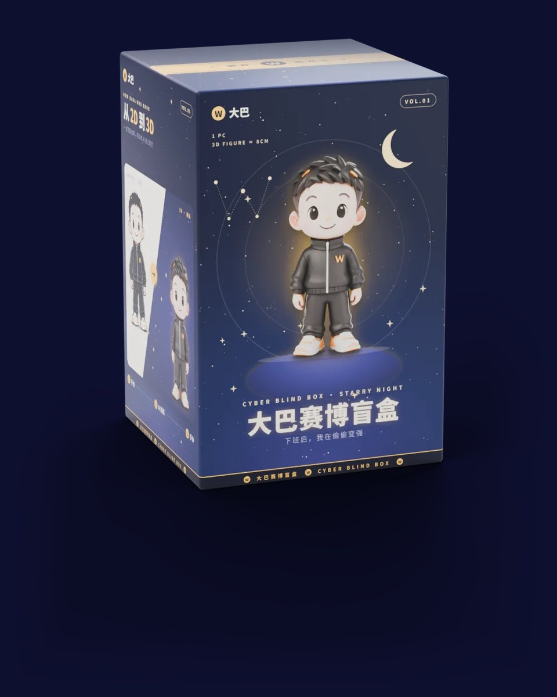
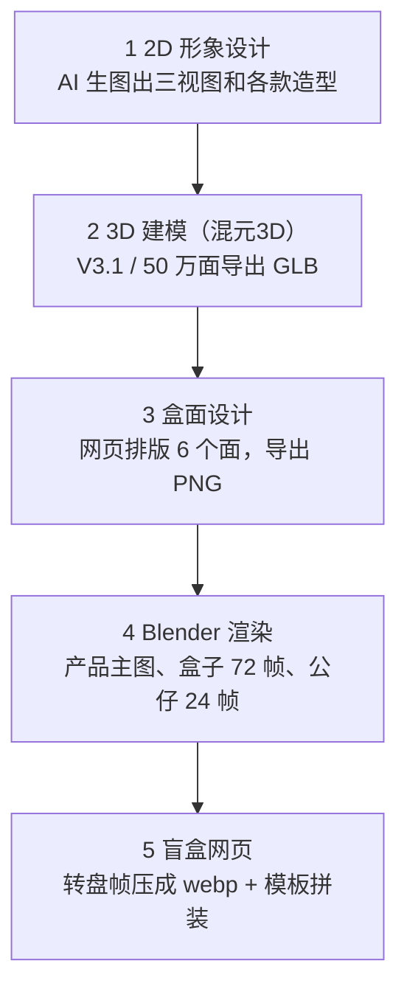

# 大巴赛博盲盒 · 产品介绍

## 一句话介绍

大巴赛博盲盒是 IP 形象「大巴」的第一套潮玩盲盒：8 款大巴公仔（7 款常规 + 1 款隐藏），加一个不在盒中出售的彩蛋角色「超能大巴」。主题是 **下班后，我在偷偷变强**，讲一个普通上班族在下班后学 AI、打篮球、熬夜充电的日常。

它目前以 **线上开盒网页** 的形式呈现：拖动 360° 查看照片级盒子，点击后盒子炸成漫天星星、公仔跳出来，可以拖着转一圈看；集齐 8 款会召唤超能大巴。

## IP 形象

大巴是一个 Q 版少年，一眼能认出的是这几处黄色细节：

| 部位 | 设定 |
| --- | --- |
| 服装 | 黑色立领拉链外套，胸口黄色 W |
| 头发 | 黑色短发，夹着几缕黄色发线 |
| 鼻子 | 一颗黄色圆点 |
| 鞋子 | 白黄配色球鞋 |
| 气质 | 乖、认真，带一点下班后的小疲惫 |

## 产品系列

每盒随机 1 款，7 款常规 + 1 款隐藏（概率 1/12）；超能大巴只能集齐 8 款后召唤，不在盒中出售。

| 网页序号 | 款式 | 英文名 | 造型亮点 | 类别 |
| --- | --- | --- | --- | --- |
| 01 | 基础款 | Classic | 黑色运动套装，大巴的标准形象 | 常规 |
| 02 | 篮球款 | Hoop Dream | 18 号 W 球衣，抱着篮球 | 常规 |
| 03 | AI学习款 | AI Learner | 蓝白连帽卫衣 + 笔记本 + 小机器人 | 常规 |
| 04 | 学霸款 | Top Student | 双肩包 + 小本子，边走边记 | 常规 |
| 05 | 咖啡款 | Coffee Break | 灰色开衫 + 一杯咖啡，下班后充电 | 常规 |
| 06 | 新年款 | Lucky New Year | 红色唐装 + 红灯笼 | 常规 |
| 07 | 金色款 | Golden Daba | 全身金色电镀，比耶 | 常规 |
| 08 | 熬夜款 | — | 睡衣 + 眼罩 + 抱枕，打着哈欠 | 隐藏款（1/12） |
| 彩蛋 | 超能大巴 | — | 黑金战衣 + 金色披风 | 集齐 8 款召唤，不卖 |

## 包装设计

最终版是 v6「星空」：深蓝夜空底、金色点缀，盒子尺寸 6.5 × 6.5 × 9.9 cm。

| 面 | 内容 |
| --- | --- |
| 正面 | 大巴站在紫色星球上，光环、轨道、月亮和 W 星座；标题「大巴赛博盲盒」+「下班后，我在偷偷变强」 |
| 右侧面 | ALL MEMBERS · 全款展示：上排 4 款、下排 3 款，隐藏款只留金色剪影「??? · 1/12」 |
| 左侧面 | 从 2D 到 3D：手绘稿和 3D 公仔并排 |
| 背面 | 产品信息卡、警示条、金色二维码卡、条形码 |
| 顶面 | 金色撕拉条 |
| 底面 | 信息卡 |

## 线上开盒体验

一次开盒大约 3 秒，全程没有声音，也不需要登录。

1. **看盒子**：左右拖动，照片级盒子转一圈（72 张 Blender 渲染图，每 5° 一张）。
2. **拆盒**：点盒子或「拆盲盒」，盒子抖动、鼓起，然后炸成漫天星星。
3. **公仔跳出**：公仔从中间高高跳起，落地压扁再弹回；开出隐藏款时星星是金色的。
4. **转公仔**：左右拖动画面，公仔转一圈（24 张渲染图），能看到背面。
5. **收集**：开到的款式点亮下方收藏栏，进度只保存在自己的浏览器里。
6. **彩蛋**：集齐 8 款后，8 个大巴站上两层发光展台（上 4 下 4），一个个化成星光汇进光球，光柱冲天，超能大巴登场。

待做：产品闪卡（之后做好再加回开盒流程）、手机版排版。

## 制作方式

整套产品一个人在家完成，免费工具为主：AI 生图、混元3D（免费）、Blender（免费）、显卡 RTX 3070。

最耗时的是第 4 步：9 款公仔每款约 10 分钟，盒子 72 帧约 40 分钟到 1 小时。每一步的具体做法整理成了可复用的工作流：[`skills/ip-blindbox-pipeline/SKILL.md`](../skills/ip-blindbox-pipeline/SKILL.md)。

## 规格

| 项目 | 规格 |
| --- | --- |
| 公仔 | 约 9 cm 高，3D 模型每款约 50 万面 |
| 盒子 | 6.5 × 6.5 × 9.9 cm，每盒 1 个 |
| 款式 | 常规 7 款 + 隐藏 1 款（1/12）+ 彩蛋 1 个（不卖） |
| 渲染图 | 盒子 1600×2000，公仔 1200×1500 |
| 网页 | 约 11 MB，电脑浏览器；手机版待做 |
